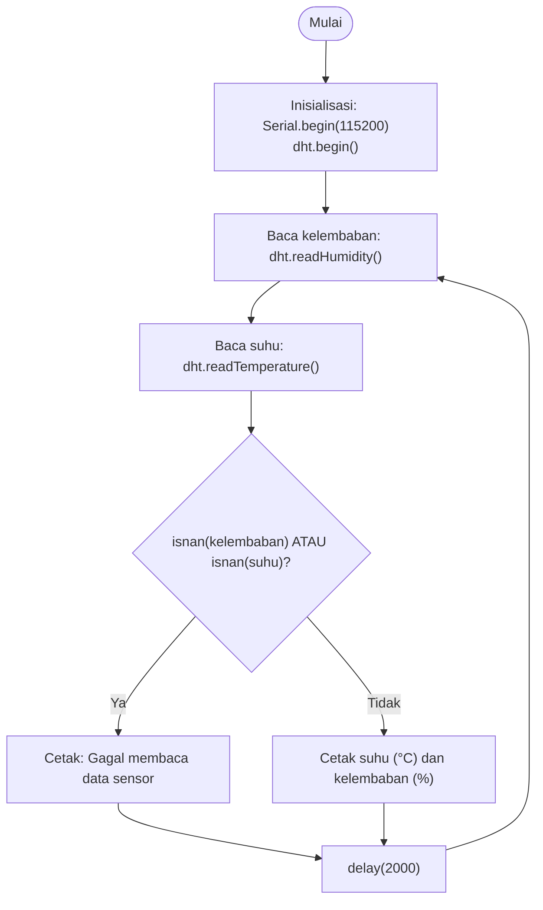

Nama: Gerard Roland Kusuma Sarwoko  
NIM: H1H024047  
Shift Awal: B  
Shift Akhir: C  

---

# Modul 1 - Sensor dan Aktuator (Akuisisi Data Sensor dan Kendali Aktuator)

## Ringkasan Praktikum
| Percobaan | Isi |
|---|---|
| 1A | Akuisisi suhu dan kelembaban dari sensor DHT, ditampilkan di Serial Monitor; tugas tambahan: rata-rata 5 pembacaan |
| 2A | Kendali aktuator (relay/LED) otomatis berdasarkan suhu; tugas tambahan: kendali histerisis (dua ambang batas) |

## Library / Dependencies
| Library | Fungsi |
|---|---|
| `DHT sensor library` (Adafruit) | Membaca suhu dan kelembaban dari DHT11/DHT22 (`dht.begin()`, `readTemperature()`, `readHumidity()`) |
| `Adafruit Unified Sensor` | Library pendukung yang dibutuhkan oleh DHT sensor library |

## Skematik Rangkaian
| Komponen | Pin | Keterangan |
|---|---|---|
| VCC sensor DHT | 3.3V | Catu daya sensor |
| DATA sensor DHT | GPIO 4 | Jalur data 1-Wire |
| GND sensor DHT | GND | Ground |
| IN relay / anoda LED | GPIO 26 | LED lewat resistor 220 Ω |
| VCC relay | 5V (VIN) | Hanya bila memakai modul relay |
| GND relay / katoda LED | GND | Ground |

> Nomor GPIO pada tabel mengikuti modul praktikum. Jika board berbeda (misalnya ESP8266), ganti dengan pin yang tersedia pada board tersebut (contoh: GPIO 4 = D2).

# Percobaan 1A - Akuisisi Data Sensor (Suhu dan Kelembaban)

## Penjelasan Singkat Percobaan
Mikrokontroler membaca suhu dan kelembaban dari sensor DHT melalui GPIO 4 dan mencetak hasilnya ke Serial Monitor setiap 2 detik. Jika pembacaan gagal (NaN), program mencetak peringatan. Program dasar membaca satu kali lalu menampilkan; pada tugas tambahan hasil ditampilkan sebagai rata-rata dari 5 kali pembacaan.

## Pertanyaan Praktikum - Percobaan 1A

### 1. Gambarkan diagram alur (flowchart) proses akuisisi data sensor pada program di atas!



### 2. Apa fungsi dari perintah `isnan()` pada program tersebut?
`isnan()` (is Not a Number) memeriksa apakah sebuah nilai float tidak berupa angka valid. Saat sensor DHT gagal dibaca (kabel longgar, sensor tidak merespons, atau dibaca terlalu cepat), library mengembalikan NaN, bukan angka. Dengan `isnan()` program bisa mengenali kegagalan itu dan menampilkan peringatan, sehingga nilai tidak valid tidak tercetak sebagai "suhu" dan tidak dipakai untuk keputusan seperti menyalakan aktuator.

### 3. Jelaskan mengapa diperlukan jeda (delay) minimal sekitar 2 detik antar pembacaan sensor DHT!
Sensor DHT butuh waktu untuk mengukur dan menyiapkan data pada register internalnya; laju sampling maksimumnya sekitar satu pembacaan tiap 2 detik (DHT22 ±0,5 Hz, DHT11 sekitar 1 Hz). Jika diminta lebih cepat, sensor bisa mengembalikan nilai lama (pembacaan sebelumnya) atau gagal merespons sehingga hasilnya NaN. Karena itu `delay(2000)` dipasang agar tiap pembacaan benar-benar data baru yang valid.

### 4. Modifikasi program agar data suhu dan kelembaban dirata-ratakan dari 5 kali pembacaan sebelum ditampilkan!

**Kode final (`Percobaan_1.ino`):**
```cpp
#include <DHT.h>

#define DHTPIN 4
#define DHTTYPE DHT11

DHT dht(DHTPIN, DHTTYPE);

// --- Kode baru: banyaknya pembacaan yang dirata-ratakan ---
const int JUMLAH_SAMPLING = 5;

void setup() {
  Serial.begin(115200);
  dht.begin();
}

void loop() {
  // --- Kode baru: penampung jumlah nilai pembacaan valid ---
  float totalSuhu = 0;
  float totalKelembaban = 0;

  // --- Kode baru: pencacah pembacaan yang berhasil ---
  int jumlahValid = 0;

  // --- Kode baru: ambil sampel sebanyak JUMLAH_SAMPLING kali ---
  for (int i = 0; i < JUMLAH_SAMPLING; i++) {
    float kelembaban = dht.readHumidity();
    float suhu = dht.readTemperature();

    if (isnan(kelembaban) || isnan(suhu)) {
      // --- Kode baru: sampel gagal dilewati, tidak ikut dijumlahkan ---
      Serial.println("Gagal membaca data dari sensor DHT11! (sampel dilewati)");
    } else {
      // --- Kode baru: sampel valid dijumlahkan dan dihitung ---
      totalSuhu += suhu;
      totalKelembaban += kelembaban;
      jumlahValid++;
    }

    delay(2000);  // jeda antar sampel sesuai batas sampling sensor
  }

  // --- Kode baru: hitung rata-rata hanya bila ada minimal satu sampel valid ---
  if (jumlahValid > 0) {
    float rataSuhu = totalSuhu / jumlahValid;
    float rataKelembaban = totalKelembaban / jumlahValid;

    Serial.print("Rata-rata Suhu: ");
    Serial.print(rataSuhu);
    Serial.print(" °C, Rata-rata Kelembaban: ");
    Serial.print(rataKelembaban);
    Serial.println(" %");
  } else {
    // --- Kode baru: semua 5 sampel gagal ---
    Serial.println("Seluruh pembacaan pada siklus ini gagal, rata-rata tidak dapat dihitung.");
  }
  // tidak perlu delay tambahan di akhir: jeda sudah ada di dalam for
}
```

**Penjelasan baris kode yang ditambahkan:**

| Baris | Penjelasan |
|---|---|
| `const int JUMLAH_SAMPLING = 5;` | Konstanta yang menentukan berapa sampel dirata-ratakan; cukup diubah di sini jika ingin jumlah lain. |
| `float totalSuhu = 0; float totalKelembaban = 0;` | Dua variabel penjumlah. Dideklarasikan di dalam `loop()` agar bernilai 0 lagi pada setiap siklus baru. |
| `int jumlahValid = 0;` | Mencacah sampel yang benar-benar valid; dipakai sebagai pembagi (bukan selalu 5) supaya sampel NaN tidak merusak rata-rata. |
| `for (int i = 0; i < JUMLAH_SAMPLING; i++)` | Perulangan yang membaca sensor 5 kali. |
| `if (isnan(...)) { ... } else { ... }` | Percabangan: sampel gagal hanya dicetak peringatannya, sampel valid dijumlahkan. |
| `totalSuhu += suhu; totalKelembaban += kelembaban; jumlahValid++;` | Menambahkan nilai ke penjumlah dan menaikkan cacah. |
| `delay(2000);` (di dalam for) | Menjaga jarak 2 detik antar sampel; satu siklus rata-rata memakan sekitar 10 detik. |
| `if (jumlahValid > 0)` | Pengaman: mencegah pembagian dengan nol jika semua sampel gagal. |
| `rataSuhu = totalSuhu / jumlahValid;` dst. | Rumus rata-rata: total dibagi banyaknya data valid. |
| `else { Serial.println("Seluruh pembacaan ... gagal ...") }` | Pesan bila tidak ada satu pun sampel valid. |

**Penjelasan fungsi keseluruhan program:**

| Bagian | Penjelasan |
|---|---|
| `#define DHTPIN 4`, `#define DHTTYPE DHT11` | Pin data dan jenis sensor. Jenis sensor harus cocok dengan perangkat keras (DHT11 atau DHT22). |
| `DHT dht(DHTPIN, DHTTYPE);` | Membuat objek sensor. |
| `setup()` | Menyalakan Serial (115200 baud) dan menginisialisasi sensor. |
| `loop()` | Mengulang terus: ambil 5 sampel, hitung rata-rata, tampilkan. |

---

# Percobaan 2A - Kendali Aktuator Relay Berdasarkan Data Sensor

## Penjelasan Singkat Percobaan
Suhu dari sensor menentukan status aktuator (relay/LED di GPIO 26) dan keduanya ditampilkan di Serial Monitor. Program dasar memakai **satu** ambang batas (30 °C). Pada tugas tambahan dipakai **dua** ambang batas (histerisis): ON di atas 30 °C dan baru OFF di bawah 28 °C.

## Pertanyaan Praktikum - Percobaan 2A

### 1. Mengapa diperlukan nilai ambang batas (threshold) dalam sistem kendali aktuator berbasis sensor?
Sensor menghasilkan nilai yang kontinu, sedangkan aktuator hanya punya keadaan tegas (ON/OFF). Threshold adalah "garis pemisah" yang mengubah nilai kontinu menjadi keputusan: di sisi mana suhu berada menentukan aktuator menyala atau mati. Tanpa threshold mikrokontroler tidak punya patokan kapan harus bertindak, sehingga keputusan tidak konsisten dan harus dilakukan manual.

### 2. Jelaskan apa yang akan terjadi apabila nilai `suhuThreshold` diturunkan menjadi sangat rendah, misalnya 20.0!
Suhu ruangan umumnya sudah di atas 20 °C, sehingga kondisi `suhu > 20.0` hampir selalu benar dan aktuator menyala hampir terus-menerus. Aktuator tidak lagi menandakan kondisi panas yang istimewa. Pada kasus nyata (relay untuk kipas atau pompa), pemakaian terus-menerus memboroskan listrik dan mempercepat keausan komponen.

### 3. Apa perbedaan antara kendali aktuator dengan kondisi tunggal dan kendali menggunakan histerisis (dua ambang batas)?
| Aspek | Satu ambang batas | Histerisis (dua ambang) |
|---|---|---|
| Pemicu ON | Suhu melewati batas | Suhu melewati batas atas |
| Pemicu OFF | Suhu kembali melewati batas yang sama | Suhu turun melewati batas bawah (lebih rendah) |
| Perilaku di sekitar batas | Aktuator bisa berganti ON/OFF berulang kali (chattering) bila suhu naik-turun tipis di sekitar batas | Ada "zona mati" antara kedua batas sehingga status bertahan dan lebih stabil |
| Dampak | Menyulitkan, merusak relay | Aktuator lebih awet dan kerja lebih halus |

### 4. Modifikasi program agar menggunakan dua ambang batas (histerisis): menyala pada suhu di atas 30°C dan mati pada suhu di bawah 28°C!

**Kode final (`Percobaan_2.ino`):**
```cpp
#include <DHT.h>

#define DHTPIN 4
#define DHTTYPE DHT11
#define RELAYPIN 26

DHT dht(DHTPIN, DHTTYPE);

// --- Kode baru: dua ambang batas menggantikan satu suhuThreshold ---
const float batasAtas = 30.0;   // di atas nilai ini aktuator dinyalakan
const float batasBawah = 28.0;  // di bawah nilai ini aktuator dimatikan

// --- Kode baru: variabel pengingat status aktuator ---
bool statusAktuator = false;    // false = OFF, true = ON

void setup() {
  Serial.begin(115200);
  dht.begin();

  pinMode(RELAYPIN, OUTPUT);
  digitalWrite(RELAYPIN, LOW);  // aktuator mati di awal
  statusAktuator = false;       // --- Kode baru: samakan variabel dengan kondisi fisik awal
}

void loop() {
  float suhu = dht.readTemperature();

  if (isnan(suhu)) {
    // pembacaan gagal: status aktuator dibiarkan seperti sebelumnya
    Serial.println("Gagal membaca suhu dari sensor DHT11!");
  } else {
    // --- Kode baru: logika histerisis menggantikan if-else tunggal ---
    if (suhu > batasAtas) {
      statusAktuator = true;     // terlalu panas -> ON
    } else if (suhu < batasBawah) {
      statusAktuator = false;    // sudah cukup dingin -> OFF
    }
    // --- Kode baru: untuk suhu 28-30 °C tidak ada else, sehingga status
    // tidak berubah dan mengikuti kondisi sebelumnya (inti histerisis)

    // --- Kode baru: terapkan status ke pin fisik ---
    digitalWrite(RELAYPIN, statusAktuator ? HIGH : LOW);

    Serial.print("Suhu: ");
    Serial.print(suhu);
    Serial.print(" °C, Aktuator: ");
    // --- Kode baru: tampilkan status dari variabel, bukan dari hasil if sesaat ---
    Serial.println(statusAktuator ? "ON" : "OFF");
  }

  delay(2000);
}
```

**Penjelasan baris kode yang ditambahkan:**

| Baris | Penjelasan |
|---|---|
| `const float batasAtas = 30.0;` | Ambang untuk **menyalakan** aktuator. |
| `const float batasBawah = 28.0;` | Ambang untuk **mematikan** aktuator. Selisih 2 °C antara kedua batas adalah lebar histerisis. |
| `bool statusAktuator = false;` | Variabel global yang mengingat status terakhir. Karena global, nilainya bertahan antar putaran `loop()`; ini yang membuat zona 28-30 °C bisa "mengingat" kondisi sebelumnya. |
| `statusAktuator = false;` di `setup()` | Menyamakan variabel dengan kondisi pin yang baru dimatikan. |
| `if (suhu > batasAtas) { statusAktuator = true; }` | Suhu melewati batas atas -> status ON. |
| `else if (suhu < batasBawah) { statusAktuator = false; }` | Suhu turun di bawah batas bawah -> status OFF. |
| (tanpa `else` terakhir) | Saat suhu 28-30 °C tidak ada yang terpenuhi, status tidak berubah. Itulah histerisis. |
| `digitalWrite(RELAYPIN, statusAktuator ? HIGH : LOW);` | Operator ternary: `true` -> HIGH (aktif), `false` -> LOW (mati). Aktuator dikendalikan lewat variabel, bukan langsung oleh perbandingan suhu. |
| `Serial.println(statusAktuator ? "ON" : "OFF");` | Menampilkan status sesungguhnya yang sedang dipakai. |

**Contoh urutan kerja:**
| Suhu terbaca | Kondisi | Aktuator |
|---|---|---|
| 27.0 | < 28 | OFF |
| 29.0 | di antara 28 dan 30 | OFF (tetap) |
| 30.5 | > 30 | ON |
| 29.0 | di antara 28 dan 30 | ON (tetap) |
| 27.5 | < 28 | OFF |

---

## Pertanyaan Analisis

### 1. Uraikan hasil tugas pada praktikum yang telah dilakukan pada setiap percobaan!
**Percobaan 1A:** Sensor berhasil dibaca dan Serial Monitor menampilkan suhu dan kelembaban tiap 2 detik tanpa error. Pada tugas tambahan, tampilan berupa rata-rata 5 pembacaan sehingga angka lebih stabil. Pengujian saat sensor disentuh/didekatkan sumber dingin-panas menunjukkan nilai berubah sesuai kondisi, dan tidak ada pembacaan NaN.

**Percobaan 2A:** Aktuator berubah ON/OFF otomatis berdasarkan suhu. Pada program dasar aktuator ON saat suhu melewati ambang. Pada tugas tambahan, aktuator ON setelah suhu melewati 30 °C dan tetap ON sampai suhu turun di bawah 28 °C, sehingga tidak berkedip di sekitar batas.

### 2. Bagaimana pengaruh akurasi dan waktu tanggap (response time) sensor terhadap kecepatan reaksi aktuator pada sistem IoT?
Akurasi menentukan apakah keputusan aktuator didasarkan pada nilai yang benar: sensor yang meleset ±2 °C bisa membuat aktuator menyala terlalu cepat atau terlambat dari kondisi sebenarnya. Waktu tanggap menentukan seberapa cepat perubahan lingkungan terlihat oleh sistem: sensor lambat (DHT hanya menghasilkan data baru tiap ±2 detik) membuat aktuator bereaksi terlambat pada perubahan mendadak. Reaksi aktuator hanya bisa secepat dan setepat data yang diterimanya, sehingga sensor yang akurat dan cepat menghasilkan sistem yang presisi dan responsif.

### 3. Bagaimana cara kerja sistem dalam mengubah data sensor menjadi keputusan kendali aktuator (proses akuisisi hingga aktuasi)?
1. **Akuisisi:** sensor DHT mengukur suhu/kelembaban dan mengirimnya sebagai data digital lewat jalur data (GPIO 4).
2. **Pembacaan:** mikrokontroler memanggil `dht.readTemperature()` / `readHumidity()` dari library DHT.
3. **Validasi:** `isnan()` memeriksa data; data NaN dibuang.
4. **Keputusan:** suhu valid dibandingkan dengan threshold lewat struktur `if-else` (atau dua threshold pada histerisis).
5. **Aktuasi:** hasil keputusan dikirim ke pin keluaran dengan `digitalWrite()` (HIGH/LOW) sehingga relay/LED berubah.
6. **Umpan balik:** status ditampilkan di Serial Monitor, lalu siklus diulang.

### 4. Bagaimana kombinasi antara akuisisi data sensor dan kendali aktuator dapat digunakan untuk membangun sistem IoT yang responsif terhadap perubahan kondisi lingkungan, misalnya pada smart farming atau smart home?
Gabungan keduanya membentuk sistem *closed-loop*: kondisi lingkungan diukur, diolah, lalu langsung memicu tindakan tanpa campur tangan manusia. Pada smart farming, sensor kelembaban tanah/suhu udara dapat menyalakan pompa irigasi atau kipas ventilasi saat melewati ambang, menjaga tanaman tetap optimal sambil menghemat air. Pada smart home, suhu ruangan dapat mengatur AC atau kipas, dan sensor lain dapat memicu alarm. Dengan koneksi internet, pengguna juga dapat memantau dan mengubah ambang dari jauh, dan data historisnya dapat dianalisis untuk menyempurnakan pengaturan.
