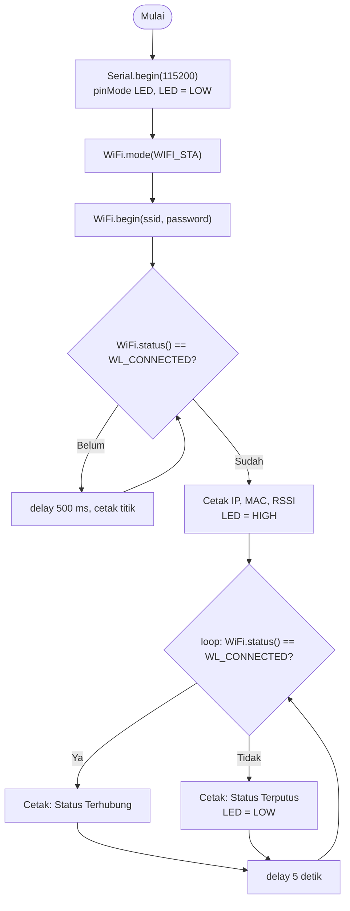

Nama: Gerard Roland Kusuma Sarwoko  
NIM: H1H024047  
Shift Awal: B  
Shift Akhir: C  

---

# Modul 2 - Konfigurasi Jaringan (WiFi Mode Station dan Access Point)

## Ringkasan Praktikum
| Percobaan | Mode | Isi |
|---|---|---|
| 2A | Station (STA) | Board terhubung ke WiFi yang tersedia, menampilkan IP, MAC, RSSI; tugas tambahan: reconnect otomatis |
| 2B | Access Point (AP) | Board membuat jaringan WiFi sendiri; tugas tambahan: mode gabungan AP+STA |

## Library / Dependencies
| Library | Fungsi |
|---|---|
| `WiFi.h` | Konfigurasi dan pemantauan WiFi: `WiFi.mode()`, `WiFi.begin()`, `WiFi.status()`, `WiFi.localIP()`, `WiFi.macAddress()`, `WiFi.RSSI()`, `WiFi.softAP()`, `WiFi.softAPIP()`, `WiFi.softAPgetStationNum()` |

> Kode mengikuti modul (`WiFi.h`). Jika board yang dipakai ESP8266, ganti dengan `#include <ESP8266WiFi.h>`; fungsi-fungsi di atas memiliki nama yang sama.

## Skematik Rangkaian
| Komponen | Pin | Keterangan |
|---|---|---|
| LED (anoda) | GPIO 2 (melalui resistor 220 Ω) | Indikator status koneksi (opsional, LED bawaan board juga bisa) |
| LED (katoda) | GND | Ground |

# Percobaan 2A - Konfigurasi Mode Station (STA)

## Penjelasan Singkat Percobaan
Board diatur sebagai klien WiFi (Station) dan tersambung ke jaringan yang sudah ada. Setelah tersambung, Serial Monitor menampilkan status, IP address, MAC address, dan RSSI, serta LED menyala sebagai indikator.

**Program dasar modul (untuk melihat IP, MAC, RSSI):**
```cpp
#include <WiFi.h>

const char* ssid     = "NAMA_WIFI_ANDA";
const char* password = "PASSWORD_WIFI_ANDA";
const int ledPin = 2;   // LED indikator

void setup() {
  Serial.begin(115200);
  pinMode(ledPin, OUTPUT);
  digitalWrite(ledPin, LOW);

  WiFi.mode(WIFI_STA);            // jadikan board sebagai klien
  WiFi.begin(ssid, password);     // mulai koneksi

  Serial.print("Menghubungkan ke WiFi");
  while (WiFi.status() != WL_CONNECTED) {   // tunggu sampai terhubung
    delay(500);
    Serial.print(".");
  }

  Serial.println();
  Serial.println("WiFi berhasil terhubung!");
  Serial.print("IP Address  : ");  Serial.println(WiFi.localIP());      // IP dari router
  Serial.print("MAC Address : ");  Serial.println(WiFi.macAddress());   // alamat fisik board
  Serial.print("RSSI (dBm)  : ");  Serial.println(WiFi.RSSI());         // kekuatan sinyal
  digitalWrite(ledPin, HIGH);     // LED menyala = terhubung
}

void loop() {
  if (WiFi.status() == WL_CONNECTED) {
    Serial.println("Status: Terhubung");
  } else {
    Serial.println("Status: Terputus");
    digitalWrite(ledPin, LOW);
  }
  delay(5000);   // cek status tiap 5 detik
}
```

## Pertanyaan Praktikum - Percobaan 2A

### 1. Gambarkan diagram alur (flowchart) proses koneksi ESP32 ke jaringan WiFi pada program di atas!



### 2. Apa fungsi dari perintah `WiFi.mode(WIFI_STA)` pada program tersebut?
Perintah ini menetapkan peran radio WiFi sebagai **Station**, yaitu klien yang menyambung ke access point (router/hotspot) yang sudah ada, bukan sebagai pemancar jaringan. Board mendukung beberapa mode (STA, AP, AP+STA) dengan perilaku berbeda. Dengan menyebutkan mode secara eksplisit di awal, `WiFi.begin()` dipastikan bekerja sebagai klien tanpa bergantung pada mode bawaan atau mode sisa dari program sebelumnya.

### 3. Jelaskan apa yang terjadi apabila SSID atau password yang dimasukkan salah!
- **SSID salah:** access point yang dituju tidak ditemukan sehingga status tidak pernah menjadi `WL_CONNECTED`. Program berputar di `while` dan terus mencetak titik.
- **Password salah:** access point ditemukan, tetapi proses autentikasi ditolak, dan hasilnya sama: status tidak pernah terhubung dan program tertahan di `while`.
Pada program dasar tidak ada pesan yang membedakan kedua penyebab dan tidak ada batas waktu, sehingga program menunggu selamanya. Karena itu pada tugas tambahan ditambahkan timeout.

### 4. Modifikasi program agar ESP32 mencoba menghubungkan ulang (reconnect) secara otomatis apabila koneksi WiFi terputus!

**Kode final (`Percobaan_2A_STA.ino`):**
```cpp
#include <WiFi.h>

const char* ssid     = "NAMA_WIFI_ANDA";
const char* password = "PASSWORD_WIFI_ANDA";
const int ledPin = 2;

// --- Kode baru: variabel untuk pemeriksaan berkala ---
unsigned long waktuTerakhirCek = 0;        // waktu (millis) pengecekan terakhir
const unsigned long intervalCek = 5000;    // pengecekan tiap 5 detik

void hubungkanWiFi() {
  // --- Kode baru: proses koneksi dibuat fungsi agar bisa dipanggil ulang ---
  WiFi.mode(WIFI_STA);
  WiFi.begin(ssid, password);
  Serial.print("Menghubungkan ke WiFi");

  // --- Kode baru: timeout 10 detik agar tidak menunggu selamanya ---
  unsigned long waktuMulai = millis();
  while (WiFi.status() != WL_CONNECTED && millis() - waktuMulai < 10000) {
    delay(500);
    Serial.print(".");
  }

  if (WiFi.status() == WL_CONNECTED) {
    Serial.println("\nWiFi berhasil terhubung!");
    digitalWrite(ledPin, HIGH);
  } else {
    Serial.println("\nGagal terhubung, akan dicoba lagi nanti.");
    digitalWrite(ledPin, LOW);
  }
}

void setup() {
  Serial.begin(115200);
  pinMode(ledPin, OUTPUT);
  digitalWrite(ledPin, LOW);
  hubungkanWiFi();   // koneksi pertama
}

void loop() {
  // --- Kode baru: cek berkala tanpa delay panjang yang memblokir ---
  if (millis() - waktuTerakhirCek >= intervalCek) {
    waktuTerakhirCek = millis();

    if (WiFi.status() == WL_CONNECTED) {
      Serial.println("Status: Terhubung");
    } else {
      // --- Kode baru: bila putus, hubungkan ulang otomatis ---
      Serial.println("Status: Terputus, mencoba menghubungkan ulang...");
      digitalWrite(ledPin, LOW);
      hubungkanWiFi();
    }
  }
}
```

**Penjelasan baris kode yang ditambahkan:**

| Baris | Penjelasan |
|---|---|
| `unsigned long waktuTerakhirCek = 0;` | Menyimpan kapan terakhir kali status dicek, untuk penjadwalan dengan `millis()`. |
| `const unsigned long intervalCek = 5000;` | Selang antar pengecekan (5 detik). |
| `void hubungkanWiFi() { ... }` | Seluruh proses koneksi dipindah ke fungsi, sehingga dapat dipakai di `setup()` dan dipanggil lagi saat koneksi putus. |
| `unsigned long waktuMulai = millis();` | Mencatat saat percobaan koneksi dimulai. |
| `while (status != CONNECTED && millis() - waktuMulai < 10000)` | Perulangan menunggu dibatasi dua syarat: belum terhubung **dan** belum lewat 10 detik. Jika SSID/password salah, perulangan berhenti sendiri. |
| `if (WiFi.status() == WL_CONNECTED) ... else ...` | Setelah menunggu, program memberi laporan sukses atau gagal, dan LED mengikuti hasil. |
| `if (millis() - waktuTerakhirCek >= intervalCek)` | Timer non-blocking: blok di dalamnya hanya jalan tiap 5 detik, tanpa `delay()` panjang. |
| `waktuTerakhirCek = millis();` | Menyetel ulang timer. |
| `else { ... hubungkanWiFi(); }` | Jika terdeteksi terputus, LED dimatikan lalu `hubungkanWiFi()` dipanggil untuk menyambung ulang secara otomatis. |

---

# Percobaan 2B - Konfigurasi Mode Access Point (AP)

## Penjelasan Singkat Percobaan
Board membuat jaringan WiFi sendiri bernama `ESP32_AccessPoint` (password `12345678`, IP default `192.168.4.1`). HP/laptop dapat menyambung, dan jumlah perangkat yang terhubung dipantau di Serial Monitor. Pada tugas tambahan, board dijalankan dalam mode **AP+STA**: menyediakan AP sekaligus tersambung ke WiFi rumah.

## Pertanyaan Praktikum - Percobaan 2B

### 1. Mengapa alamat IP default Access Point pada ESP32 umumnya bernilai 192.168.4.1?
Itu adalah alamat bawaan yang ditetapkan oleh firmware/SDK untuk antarmuka soft-AP. Alamat tersebut berada pada rentang IP privat (192.168.x.x) yang khusus untuk jaringan lokal dan tidak dirutekan di internet, sehingga aman dipakai tanpa bentrok. Karena selalu sama, pengguna tahu alamat perangkat tanpa perlu mencarinya (misalnya untuk membuka halaman konfigurasi). Alamat ini dapat diganti dengan `WiFi.softAPConfig()` bila diperlukan.

### 2. Apa perbedaan mendasar antara mode Station dan mode Access Point pada ESP32?
| Aspek | Station (STA) | Access Point (AP) |
|---|---|---|
| Peran | Klien yang bergabung ke jaringan lain | Pembuat/penyedia jaringan |
| Ketergantungan | Butuh router/hotspot eksternal dan kredensialnya | Mandiri, tanpa router |
| Alamat IP | Menerima IP dari DHCP server router | Memberi IP (bertindak sebagai DHCP server) ke perangkat yang tersambung |
| Fungsi utama | `WiFi.begin()` | `WiFi.softAP()` |
| Penggunaan | Mengakses internet/server | Konfigurasi awal, jaringan lokal sementara |

### 3. Jelaskan risiko keamanan apabila password Access Point tidak diberikan atau terlalu sederhana!
Siapa pun dalam jangkauan sinyal bisa bergabung. Risikonya: data yang lewat dapat disadap, penyusup dapat mengakses dan mengubah konfigurasi perangkat atau mengirim perintah palsu ke aktuator, AP dapat dibebani perangkat tak dikenal, dan password sederhana (misalnya `12345678`) mudah ditebak lewat brute force atau daftar password umum. Gunakan password panjang, acak, dan tidak mudah ditebak (WPA2).

### 4. Modifikasi program agar ESP32 berjalan pada mode AP+STA (terhubung ke WiFi rumah sekaligus menyediakan Access Point)!

**Kode final (`Percobaan_2B_AP.ino`):**
```cpp
#include <WiFi.h>

// --- Kode baru: kredensial WiFi rumah untuk sisi Station ---
const char* sta_ssid     = "NAMA_WIFI_RUMAH";
const char* sta_password = "PASSWORD_WIFI_RUMAH";

// Kredensial untuk sisi Access Point (tetap disediakan board)
const char* ap_ssid     = "ESP32_AccessPoint";
const char* ap_password = "12345678";

void setup() {
  Serial.begin(115200);

  // --- Kode baru: aktifkan mode gabungan AP + STA ---
  WiFi.mode(WIFI_AP_STA);

  // Sisi Access Point
  WiFi.softAP(ap_ssid, ap_password);
  Serial.print("AP IP Address   : ");
  Serial.println(WiFi.softAPIP());

  // --- Kode baru: sisi Station, sambung ke WiFi rumah ---
  WiFi.begin(sta_ssid, sta_password);
  Serial.print("Menghubungkan ke WiFi rumah");
  unsigned long waktuMulai = millis();
  while (WiFi.status() != WL_CONNECTED && millis() - waktuMulai < 10000) {
    delay(500);
    Serial.print(".");
  }

  if (WiFi.status() == WL_CONNECTED) {
    Serial.println();
    Serial.print("STA IP Address  : ");
    Serial.println(WiFi.localIP());
  } else {
    Serial.println("\nGagal terhubung ke WiFi rumah (mode AP tetap aktif).");
  }
}

void loop() {
  // tampilkan jumlah perangkat yang tersambung ke AP tiap 5 detik
  int jumlahClient = WiFi.softAPgetStationNum();
  Serial.print("Jumlah client AP: ");
  Serial.println(jumlahClient);
  delay(5000);
}
```

**Penjelasan baris kode yang ditambahkan:**

| Baris | Penjelasan |
|---|---|
| `sta_ssid`, `sta_password` | Kredensial WiFi rumah untuk sisi klien. Dipisahkan dari kredensial AP (`ap_ssid`, `ap_password`) agar tidak tertukar. |
| `WiFi.mode(WIFI_AP_STA);` | Mengaktifkan dua peran sekaligus: memancarkan AP dan menjadi klien. Menggantikan `WIFI_AP` pada program dasar. |
| `WiFi.softAP(ap_ssid, ap_password);` | Membuat AP; password minimal 8 karakter. |
| `WiFi.softAPIP()` | Menampilkan IP sisi AP (default 192.168.4.1). |
| `WiFi.begin(sta_ssid, sta_password);` | Memulai koneksi sisi Station ke WiFi rumah. |
| `while (... && millis() - waktuMulai < 10000)` | Menunggu maksimal 10 detik agar program tidak terjebak jika WiFi rumah tidak tersedia. |
| `if (... WL_CONNECTED) ... else ...` | Jika berhasil, tampilkan IP sisi Station (`WiFi.localIP()`); jika gagal, beri tahu bahwa AP tetap aktif. |
| `WiFi.softAPgetStationNum()` di `loop()` | Menghitung jumlah perangkat yang sedang tersambung ke AP. |

> Kedua IP berbeda: IP AP (192.168.4.1) untuk perangkat yang menyambung ke board, sedangkan IP STA diberikan oleh router rumah.

---

## Pertanyaan Analisis

### 1. Uraikan hasil tugas pada praktikum yang telah dilakukan pada setiap percobaan!
**Percobaan 2A:** Board berhasil tersambung ke WiFi dan Serial Monitor menampilkan status, IP address, MAC address, dan RSSI; LED menyala saat terhubung. Dengan SSID atau password yang sengaja diganti salah, status tidak pernah terhubung (program dasar menunggu terus), sedangkan versi tugas tambahan berhenti menunggu setelah 10 detik dan mencoba lagi pada pengecekan berikutnya.

**Percobaan 2B:** Board berhasil membuat jaringan `ESP32_AccessPoint` dengan IP `192.168.4.1`. HP/laptop dapat menyambung dan Serial Monitor menunjukkan jumlah client bertambah. Pada tugas tambahan, board menampilkan IP sisi AP sekaligus IP sisi Station dari WiFi rumah.

### 2. Bagaimana pengaruh kekuatan sinyal (RSSI) terhadap kestabilan koneksi WiFi pada perangkat IoT?
RSSI adalah kekuatan sinyal yang diterima, dalam dBm bernilai negatif; semakin mendekati 0 semakin kuat (misalnya −50 dBm baik, −85 dBm lemah). Sinyal lemah lebih mudah terganggu noise dan interferensi sehingga muncul packet loss, kecepatan turun, dan koneksi sering putus sendiri. Pada IoT yang mengirim data terus-menerus, perangkat sebaiknya ditempatkan di area dengan RSSI cukup baik (umumnya di atas sekitar −70 dBm) agar koneksi andal.

### 3. Bagaimana cara kerja ESP32 dalam membedakan peran sebagai klien (Station) dan sebagai penyedia jaringan (Access Point)?
Perbedaan ditentukan oleh mode yang diset lewat `WiFi.mode()`: `WIFI_STA` (klien), `WIFI_AP` (penyedia jaringan), atau `WIFI_AP_STA` (keduanya). Pada mode Station, `WiFi.begin()` membuat radio memindai, memilih, dan mengasosiasi ke access point eksternal, lalu meminta IP dari DHCP server router. Pada mode AP, `WiFi.softAP()` membuat radio memancarkan SSID sendiri, menangani autentikasi perangkat yang bergabung, dan memberi mereka IP sebagai DHCP server.

### 4. Bagaimana kombinasi mode Station dan Access Point (AP+STA) dapat dimanfaatkan dalam skenario nyata sistem IoT, misalnya pada proses konfigurasi awal perangkat (provisioning)?
Pada provisioning, perangkat baru belum tahu WiFi rumah pengguna. Perangkat membuka AP sementara; pengguna menyambungkan HP ke AP itu dan memasukkan SSID dan password rumah lewat halaman web sederhana yang dilayani board. Perangkat lalu menyimpan kredensial dan menyambung ke WiFi rumah lewat sisi Station, sementara AP tetap hidup sampai konfigurasi dipastikan berhasil. Dengan cara ini kredensial tidak perlu ditulis (hardcode) di kode atau memakai kabel ke komputer. Pendekatan ini umum pada perangkat komersial seperti smart plug dan smart bulb.
