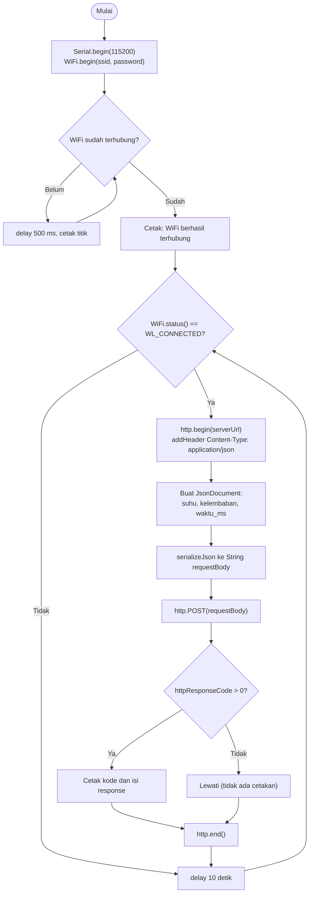

Nama: Gerard Roland Kusuma Sarwoko  
NIM: H1H024047  
Shift Awal: B  
Shift Akhir: C  

---

# Modul 3 - Protokol Komunikasi IoT (HTTP dan MQTT dengan Format JSON)

## Ringkasan Praktikum
Pada modul ini board **ESP8266** mengirim data sensor (suhu dan kelembaban) berformat JSON lewat dua protokol yang berbeda.

| Percobaan | Protokol | Tujuan |
|---|---|---|
| 3A | HTTP (metode POST) | `https://httpbin.org/post` |
| 3B | MQTT (publish) | `broker.hivemq.com` port 1883 |

> **Catatan perangkat:** modul praktikum ditulis untuk ESP32, sedangkan praktikum ini memakai ESP8266. Karena itu library WiFi dan HTTP berbeda (`ESP8266WiFi.h`, `ESP8266HTTPClient.h`), bukan `WiFi.h` dan `HTTPClient.h`. Logika programnya sama.

## Library / Dependencies
| Library | Fungsi |
|---|---|
| `ESP8266WiFi.h` | Koneksi WiFi pada ESP8266 (pengganti `WiFi.h` milik ESP32) |
| `ESP8266HTTPClient.h` | Membuat request HTTP dari ESP8266 |
| `WiFiClientSecure.h` | Dukungan koneksi aman (`https`); ikut di-include sesuai kode praktikum |
| `ArduinoJson` (Benoit Blanchon) | Membuat (serialisasi) dan membaca (deserialisasi) JSON |
| `PubSubClient` (Nick O'Leary) | Client MQTT |

Tools pendukung: Arduino IDE (board package ESP8266), MQTT Explorer / HiveMQ WebSocket Client untuk memverifikasi data.

# Percobaan 3A - Komunikasi Data Menggunakan HTTP

## Penjelasan Singkat Percobaan
ESP8266 tersambung ke WiFi, lalu tiap 10 detik membentuk JSON berisi suhu, kelembaban, dan waktu aktif (`millis()`), mengirimnya ke `httpbin.org/post` dengan HTTP POST, dan mencetak kode status serta isi balasan. `httpbin.org` akan membalas dengan data yang sama (echo) sebagai tanda data diterima.

## Pertanyaan Praktikum - Percobaan 3A

### 1. Gambarkan diagram alur (flowchart) proses pengiriman data melalui HTTP POST pada program di atas!



### 2. Apa fungsi dari perintah `http.addHeader("Content-Type", "application/json")` pada program tersebut?
Perintah itu menyisipkan header `Content-Type: application/json` ke dalam request. Header ini adalah "label" yang memberi tahu server bahwa isi body adalah teks JSON. Dengan label tersebut server dapat memilih parser JSON yang tepat. Jika header tidak ada, server menganggap body sebagai teks biasa; pada `httpbin.org` hal ini terlihat dari data yang masuk ke field `data` (string mentah), bukan ke field `json` (objek yang sudah terurai).

### 3. Jelaskan arti dari kode response HTTP 200 dan sebutkan salah satu contoh kode response HTTP lain beserta artinya!
- **200 OK** berarti request sampai ke server dan diproses tanpa masalah. Pada percobaan ini artinya `httpbin.org` menerima JSON dari ESP8266 lalu mengembalikannya sebagai response body.
- Contoh lain: **404 Not Found**, yaitu endpoint/URL yang diminta tidak ditemukan di server (misalnya salah mengetik path). Contoh lain yang umum: **400 Bad Request** (request tidak valid) dan **500 Internal Server Error** (server mengalami kegagalan).

### 4. Modifikasi program agar ESP8266 mengirimkan data tambahan berupa waktu (`millis()`) ke dalam JSON!

```cpp
#include <ESP8266WiFi.h>        // WiFi untuk ESP8266
#include <ESP8266HTTPClient.h>  // HTTP client untuk ESP8266
#include <WiFiClientSecure.h>   // dukungan koneksi aman (https)
#include <ArduinoJson.h>

const char* ssid = "eduroamer";
const char* password = "wendygantengpoll";
const char* serverUrl = "https://httpbin.org/post";

void setup() {
  Serial.begin(115200);
  WiFi.begin(ssid, password);
  while (WiFi.status() != WL_CONNECTED) {
    delay(500); Serial.print(".");
  }
  Serial.println("WiFi berhasil terhubung!");
}

void loop() {
  if (WiFi.status() == WL_CONNECTED) {
    HTTPClient http;
    http.begin(serverUrl);
    http.addHeader("Content-Type", "application/json");

    JsonDocument doc;
    doc["suhu"] = 28.5;
    doc["kelembaban"] = 65.0;
    // --- Kode baru: menambahkan data waktu sejak board dinyalakan ---
    doc["waktu_ms"] = millis();

    String requestBody;
    serializeJson(doc, requestBody);

    int httpResponseCode = http.POST(requestBody);
    if (httpResponseCode > 0) {
      Serial.println(httpResponseCode);
      Serial.println(http.getString());
    }
    http.end();
  }
  delay(10000);  // kirim data setiap 10 detik
}
```
> Catatan: jika pada versi board package ESP8266 yang dipakai muncul error saat `http.begin(serverUrl)` untuk alamat `https`, gunakan bentuk `WiFiClientSecure client; client.setInsecure(); http.begin(client, serverUrl);`. Selebihnya kode sama.

**Penjelasan baris kode yang ditambahkan:**

| Baris | Penjelasan |
|---|---|
| `doc["waktu_ms"] = millis();` | `millis()` menghasilkan jumlah milidetik sejak ESP8266 menyala. Nilainya dimasukkan sebagai key baru `waktu_ms`, sehingga JSON berbentuk `{"suhu":28.5,"kelembaban":65.0,"waktu_ms":xxxxx}`. Karena data dikirim tiap 10 detik, `waktu_ms` bertambah ±10000 pada setiap kiriman, sehingga urutan dan keterbaruan data bisa dicek di sisi server. |

**Penjelasan fungsi dan percabangan keseluruhan program:**

| Bagian | Penjelasan |
|---|---|
| Empat `#include` | Memuat library WiFi, HTTP, koneksi aman, dan JSON khusus ESP8266. |
| `setup()` | Membuka Serial 115200 baud, memulai WiFi, lalu `while` menunggu status `WL_CONNECTED` sambil mencetak titik setiap 500 ms. |
| `if (WiFi.status() == WL_CONNECTED)` | Percabangan agar request hanya dikirim bila WiFi masih aktif. |
| `http.begin(serverUrl)` | Menentukan alamat tujuan request. |
| `JsonDocument` + `serializeJson` | Membuat objek JSON lalu mengubahnya menjadi String untuk dikirim. |
| `http.POST(requestBody)` | Mengirim request dan mengembalikan kode status (negatif bila gagal). |
| `if (httpResponseCode > 0)` | Jika request berhasil terkirim, cetak kode status dan isi balasan server; jika kode negatif (gagal), tidak ada yang dicetak. |
| `http.end()` | Menutup koneksi dan membebaskan memori (penting karena RAM ESP8266 terbatas). |

---

# Percobaan 3B - Komunikasi MQTT

## Penjelasan Singkat Percobaan
ESP8266 tersambung ke WiFi dan broker `broker.hivemq.com`, lalu mem-publish JSON suhu dan kelembaban ke topic kelompok setiap 5 detik. Data dicek memakai MQTT Explorer yang subscribe pada topic yang sama.

```cpp
#include <ESP8266WiFi.h>
#include <PubSubClient.h>
#include <ArduinoJson.h>

const char* ssid = "eduroamer";
const char* password = "wendygantengpoll";

const char* mqttServer = "broker.hivemq.com";
const int mqttPort = 1883;
// topic unik memuat nama kelompok agar tidak tercampur dengan kelompok lain
const char* mqttTopic = "unsoed/tk245004/kelompokwewenroland/sensor";

WiFiClient espClient;            // media koneksi TCP
PubSubClient client(espClient);  // client MQTT di atas espClient

void hubungkanWiFi() {
  WiFi.begin(ssid, password);
  Serial.print("Menghubungkan ke WiFi");
  while (WiFi.status() != WL_CONNECTED) {
    delay(500);
    Serial.print(".");
  }
  Serial.println("\nWiFi berhasil terhubung!");
}

void hubungkanMQTT() {
  while (!client.connected()) {
    Serial.print("Menghubungkan ke broker MQTT...");
    // client ID acak supaya tidak bentrok di broker publik
    String clientId = "ESP8266Client-" + String(random(0xffff), HEX);

    if (client.connect(clientId.c_str())) {
      Serial.println("berhasil terhubung!");
    } else {
      Serial.print("gagal, rc=");
      Serial.print(client.state());
      Serial.println(" coba lagi dalam 2 detik");
      delay(2000);
    }
  }
}

void setup() {
  Serial.begin(115200);
  hubungkanWiFi();
  client.setServer(mqttServer, mqttPort);
}

void loop() {
  if (!client.connected()) {
    hubungkanMQTT();      // sambung ulang bila koneksi putus
  }
  client.loop();          // jaga koneksi dan proses paket MQTT

  JsonDocument doc;
  doc["suhu"] = 28.5;
  doc["kelembaban"] = 65.0;

  char buffer[128];
  serializeJson(doc, buffer);   // JSON -> char array

  client.publish(mqttTopic, buffer);
  Serial.print("Data terkirim ke topic ");
  Serial.print(mqttTopic);
  Serial.print(": ");
  Serial.println(buffer);

  delay(5000);  // publish tiap 5 detik
}
```

**Penjelasan fungsi dan percabangan:**

| Bagian | Penjelasan |
|---|---|
| `WiFiClient` + `PubSubClient` | `PubSubClient` memerlukan client jaringan sebagai jalur transport; `espClient` menyediakan koneksi TCP-nya. |
| `hubungkanWiFi()` | Memulai WiFi dan menunggu hingga tersambung. |
| `hubungkanMQTT()` | `while (!client.connected())` mencoba `connect()` berulang kali. Jika berhasil, cetak sukses; jika gagal (`else`), cetak kode `rc` dari `client.state()` lalu tunggu 2 detik. |
| `client.setServer()` | Menetapkan alamat dan port broker. |
| `if (!client.connected())` di `loop()` | Mendeteksi putusnya koneksi dan menyambungkan ulang. |
| `client.loop()` | Mengurus keep-alive dan pesan masuk. |
| `serializeJson(doc, buffer)` | Membuat payload teks dari objek JSON. |
| `client.publish(topic, payload)` | Mengirim payload ke topic pada broker. |

## Pertanyaan Praktikum - Percobaan 3B

### 1. Apa fungsi dari topic pada protokol MQTT, dan mengapa topic yang digunakan perlu dibuat unik?
Topic adalah alamat logis sebuah pesan, berbentuk string berjenjang seperti `unsoed/tk245004/kelompokwewenroland/sensor`. Broker memakai topic untuk memutuskan pesan harus diteruskan ke subscriber mana. Pada broker publik seperti `broker.hivemq.com`, ribuan orang memakai server yang sama. Jika topic kita sama dengan milik kelompok lain, pesan akan saling bercampur: data kita bisa terbaca orang lain, dan data orang lain ikut muncul di aplikasi kita. Maka topic dibuat unik dengan menyertakan identitas kelompok atau perangkat.

### 2. Jelaskan fungsi dari perintah `client.loop()` yang dipanggil pada setiap iterasi `loop()`!
`client.loop()` adalah rutin pemeliharaan milik PubSubClient. Fungsi ini membaca data yang datang dari broker, memanggil callback bila ada pesan, dan mengirim paket PINGREQ secara berkala sebagai keep-alive. Bila tidak dipanggil secara rutin, broker tidak menerima tanda "client masih hidup" dan akan memutus koneksi, walaupun WiFi sebenarnya masih tersambung.

### 3. Apa yang akan terjadi apabila koneksi ke broker MQTT terputus di tengah program berjalan?
`client.connected()` menjadi `false`. Pada iterasi `loop()` berikutnya kondisi `if (!client.connected())` terpenuhi dan `hubungkanMQTT()` dipanggil. Fungsi ini terus mencoba tersambung (jeda 2 detik tiap gagal) dengan client ID baru. Selama itu publish tidak berjalan sehingga ada celah data. Setelah tersambung kembali, publish berlanjut normal; data pada masa putus tidak dikirim ulang karena tidak ada mekanisme penyimpanan.

---

## Pertanyaan Analisis

### 1. Uraikan hasil tugas pada praktikum yang telah dilakukan pada setiap percobaan!
**Percobaan 3A:** ESP8266 tersambung ke WiFi dan mengirim JSON (`suhu`, `kelembaban`, `waktu_ms`) ke `httpbin.org/post` tiap 10 detik. Serial Monitor menampilkan kode **200** dan balasan server yang memuat kembali JSON yang dikirim pada field `json`. Nilai `waktu_ms` naik ±10.000 pada tiap kiriman.

**Percobaan 3B:** ESP8266 tersambung ke `broker.hivemq.com` dan mem-publish JSON tiap 5 detik. Serial Monitor menampilkan status koneksi dan setiap data terkirim, dan pesan yang sama muncul di MQTT Explorer yang subscribe ke topic kelompok.

### 2. Bandingkan besar overhead data dan pola komunikasi antara protokol HTTP dan MQTT berdasarkan hasil percobaan yang telah dilakukan!
| Aspek | HTTP (3A) | MQTT (3B) |
|---|---|---|
| Pola | Request-response, klien harus meminta lalu server membalas | Publish-subscribe melalui broker |
| Koneksi | Dibuka-ditutup tiap pengiriman (`begin` sampai `end`), termasuk handshake TLS | Dibuka sekali, lalu dipertahankan |
| Overhead | Besar: header request (method, host, content-type, content-length, dsb.) dan balasan server yang panjang | Kecil: header tetap hanya beberapa byte + nama topic + payload |
| Distribusi data | Satu penerima (server tujuan) | Banyak subscriber bisa menerima pesan yang sama |

Pada percobaan terlihat bahwa balasan HTTP yang tercetak jauh lebih panjang daripada JSON yang dikirim, sedangkan pada MQTT hanya payload JSON yang tampil.

### 3. Untuk skenario pengiriman data sensor secara terus-menerus setiap beberapa detik dalam jangka waktu lama, protokol manakah yang lebih sesuai? Jelaskan alasannya!
**MQTT.** Koneksi persisten menghilangkan handshake berulang, sehingga hemat daya dan bandwidth, hal yang penting bagi perangkat berdaya kecil seperti ESP8266 yang RAM-nya terbatas (TLS pada HTTP juga memakan banyak memori). Overhead paketnya kecil, dan model publish-subscribe membuat satu data bisa dipakai dashboard, database, dan aplikasi lain sekaligus. HTTP lebih pas untuk komunikasi sesekali.

### 4. Bagaimana peran format JSON dalam mendukung interoperabilitas data antara perangkat IoT dan berbagai platform/aplikasi yang berbeda?
JSON adalah format teks standar yang tidak terikat bahasa pemrograman maupun platform. Struktur key-value-nya mudah dibaca manusia dan dapat diurai oleh hampir semua bahasa (C++, Python, JavaScript, Java). Akibatnya data dari ESP8266 dapat langsung dimanfaatkan server, dashboard, database, atau aplikasi mobile tanpa konversi khusus, selama nama key disepakati bersama.
