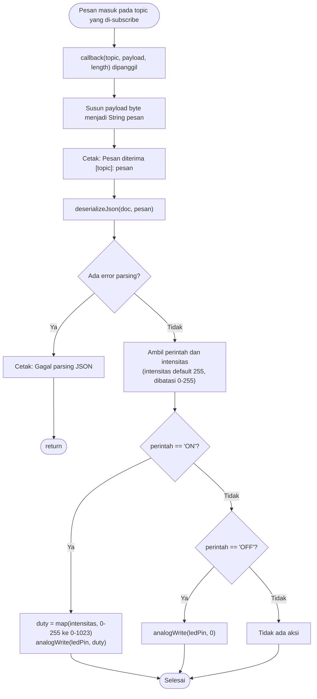

Nama: Gerard Roland Kusuma Sarwoko  
NIM: H1H024047  
Shift Awal: B  
Shift Akhir: C

---

# Modul 4 - Komunikasi dan Pertukaran Data Dua Arah (Publish dan Subscribe)

## Ringkasan Praktikum
Pada Modul 3 perangkat hanya **mengirim** data. Pada modul ini ESP8266 juga **menerima** perintah dari broker MQTT.

| Percobaan | Isi |
|---|---|
| 4A | Subscribe topic perintah, deserialisasi JSON, kendali kecerahan LED dengan PWM |
| 4B | Publish suhu + subscribe perintah bersamaan (full duplex) tanpa `delay()` blocking, dengan dua aktuator (LED dan buzzer) |

> **Catatan perangkat:** praktikum memakai **ESP8266**, sehingga memakai `ESP8266WiFi.h`, penamaan pin `D1/D2/D5`, dan PWM dengan `analogWrite()` (pada ESP8266 rentang duty bawaan 0-1023). Hal ini berbeda dari modul yang ditulis untuk ESP32 (`WiFi.h`, GPIO 26, `ledcWrite`).

## Library / Dependencies
| Library | Fungsi |
|---|---|
| `ESP8266WiFi.h` | Koneksi WiFi ESP8266 |
| `PubSubClient` | Publish dan subscribe MQTT |
| `ArduinoJson` | Serialisasi dan deserialisasi JSON |
| `DHT sensor library` (Adafruit) | Membaca sensor DHT (4B) |

## Skematik Rangkaian
| Komponen | Pin ESP8266 | GPIO |
|---|---|---|
| LED (+ resistor 220 Ω) | D1 | GPIO5 |
| DHT11 (data) | D2 | GPIO4 |
| Buzzer (tugas tambahan 4B) | D5 | GPIO14 |
| VCC DHT | 3V3 | - |
| GND semua komponen | GND | - |

# Percobaan 4A - Subscribe dan Deserialisasi JSON untuk Kendali Aktuator

## Penjelasan Singkat Percobaan
ESP8266 subscribe ke topic `.../perintah`. Setiap pesan JSON seperti `{"perintah":"ON","intensitas":200}` yang masuk memicu fungsi `callback()`. Pesan diurai dengan `deserializeJson()`, lalu LED dinyalakan/dimatikan dengan kecerahan sesuai `intensitas`.

## Pertanyaan Praktikum - Percobaan 4A

### 1. Gambarkan diagram alur (flowchart) proses penerimaan dan pemrosesan pesan pada fungsi callback di atas!



### 2. Apa yang akan terjadi apabila pesan yang dipublikasikan bukan merupakan format JSON yang valid?
`deserializeJson()` mengembalikan kode error (misalnya `InvalidInput` untuk teks polos seperti `ON`, atau `IncompleteInput` bila JSON terpotong). Kondisi `if (error)` jadi benar, program mencetak "Gagal parsing JSON: ..." lalu `return` dari callback. LED tidak berubah, program tidak berhenti, dan koneksi MQTT tetap hidup untuk pesan berikutnya. Pesan mentah tetap tercetak karena dicetak sebelum proses parsing.

### 3. Jelaskan mengapa fungsi `client.subscribe()` dipanggil di dalam fungsi `hubungkanMQTT()`, bukan di dalam `setup()`!
Ada dua alasan. Pertama, `subscribe()` hanya berhasil jika client sudah tersambung ke broker, sementara di `setup()` baru `setServer()` yang dipanggil dan koneksi belum dibuat. Kedua, langganan menempel pada sesi koneksi. Ketika koneksi putus dan dibuat lagi (dengan client ID acak), broker tidak mengingat langganan sesi lama. Jika `subscribe()` hanya ada di `setup()` yang berjalan sekali, perangkat bisa tersambung lagi tetapi tidak lagi menerima perintah. Menaruhnya tepat setelah `connect()` berhasil memastikan langganan dipasang ulang pada setiap koneksi.

### 4. Modifikasi program agar JSON yang diterima juga memuat nilai intensitas untuk mengatur kecerahan LED menggunakan PWM!

```cpp
#include <ESP8266WiFi.h>
#include <PubSubClient.h>
#include <ArduinoJson.h>

const char* ssid = "eduroamer";
const char* password = "wendygantengpoll";
const char* mqttServer = "broker.hivemq.com";
const int mqttPort = 1883;
const char* topicPerintah =
  "unsoed/tk245004/kelompokwewenroland/perintah";

const int ledPin = D1;  // D1 mendukung PWM pada ESP8266

WiFiClient espClient;
PubSubClient client(espClient);

// callback dipanggil otomatis tiap ada pesan baru
void callback(char* topic, byte* payload, unsigned int length) {
  String pesan;
  for (unsigned int i = 0; i < length; i++) pesan += (char)payload[i];

  Serial.print("Pesan diterima [");
  Serial.print(topic);
  Serial.print("]: ");
  Serial.println(pesan);

  // Deserialisasi JSON
  JsonDocument doc;
  DeserializationError error = deserializeJson(doc, pesan);
  if (error) {
    Serial.print("Gagal parsing JSON: ");
    Serial.println(error.c_str());
    return;
  }

  const char* perintah = doc["perintah"] | "";          // [BARU] default string kosong
  int intensitas = doc["intensitas"] | 255;             // [BARU] default 255
  intensitas = constrain(intensitas, 0, 255);           // [BARU] batasi 0-255

  if (String(perintah) == "ON") {
    int duty = map(intensitas, 0, 255, 0, 1023);        // [BARU] skala ke rentang PWM ESP8266
    analogWrite(ledPin, duty);                          // [BARU] atur kecerahan
    Serial.print("Aktuator: ON, intensitas = ");        // [BARU]
    Serial.print(intensitas);                           // [BARU]
    Serial.print(" (duty PWM = ");                      // [BARU]
    Serial.print(duty);                                 // [BARU]
    Serial.println(")");                                // [BARU]
  } else if (String(perintah) == "OFF") {
    analogWrite(ledPin, 0);                             // [BARU] LED mati
    Serial.println("Aktuator: OFF");
  }
}

void hubungkanWiFi() {
  WiFi.begin(ssid, password);
  Serial.print("Menghubungkan ke WiFi");
  while (WiFi.status() != WL_CONNECTED) {
    delay(500);
    Serial.print(".");
  }
  Serial.println("\nWiFi berhasil terhubung!");
}

void hubungkanMQTT() {
  while (!client.connected()) {
    String clientId = "ESP8266Client-" + String(random(0xffff), HEX);
    if (client.connect(clientId.c_str())) {
      client.subscribe(topicPerintah);   // subscribe setelah koneksi berhasil
      Serial.println("Terhubung & subscribe topic perintah");
    } else {
      delay(2000);
    }
  }
}

void setup() {
  Serial.begin(115200);
  pinMode(ledPin, OUTPUT);
  analogWrite(ledPin, 0);                               // [BARU] LED mati di awal
  hubungkanWiFi();
  client.setServer(mqttServer, mqttPort);
  client.setCallback(callback);
}

void loop() {
  if (!client.connected()) hubungkanMQTT();
  client.loop();   // wajib dipanggil terus agar pesan masuk terproses
}
```

**Penjelasan baris kode yang ditambahkan ([BARU]):**

| Baris | Penjelasan |
|---|---|
| `doc["perintah"] \| ""` | Operator `\|` pada ArduinoJson memberi nilai cadangan. Jika key `perintah` tidak ada, hasilnya string kosong (bukan pointer `NULL`), sehingga `String(perintah)` aman dipakai. |
| `int intensitas = doc["intensitas"] \| 255;` | Mengambil nilai kecerahan dari JSON. Bila tidak dikirim, LED menyala penuh (255). |
| `constrain(intensitas, 0, 255)` | Memaksa nilai tetap di 0-255, kalau pengguna mengetik angka di luar rentang. |
| `map(intensitas, 0, 255, 0, 1023)` | Mengubah skala 8-bit (0-255) menjadi skala PWM ESP8266 (0-1023). Tanpa ini, nilai 255 hanya akan menghasilkan sekitar 25% kecerahan. |
| `analogWrite(ledPin, duty)` | Menghasilkan sinyal PWM pada D1; semakin besar `duty`, semakin terang LED. |
| `analogWrite(ledPin, 0)` | Duty 0 berarti LED mati. |
| `Serial.print(... intensitas / duty ...)` | Menampilkan nilai yang dipakai agar mudah diverifikasi di Serial Monitor. |
| `analogWrite(ledPin, 0)` di `setup()` | Menjamin LED dalam keadaan mati saat program mulai. |

**Penjelasan fungsi dan percabangan keseluruhan program:**

| Bagian | Penjelasan |
|---|---|
| `callback()` | Dipanggil otomatis PubSubClient saat pesan masuk: mengubah payload menjadi String, mencetak, mem-parsing JSON, lalu mengatur LED. |
| `if (error)` | Menangani JSON tidak valid dengan mencetak error dan keluar. |
| `if ON ... else if OFF` | Memilih aksi LED sesuai perintah; perintah lain diabaikan. |
| `hubungkanMQTT()` | Menyambung ke broker (client ID acak), lalu subscribe; jika gagal tunggu 2 detik dan coba lagi. |
| `loop()` | Menyambung ulang bila putus dan memanggil `client.loop()` tanpa jeda. |

**Contoh uji dari MQTT Explorer (publish ke topic perintah):**

| Pesan | Hasil yang diharapkan |
|---|---|
| `{"perintah":"ON","intensitas":50}` | LED menyala redup |
| `{"perintah":"ON","intensitas":200}` | LED terang |
| `{"perintah":"ON"}` | LED terang penuh (default 255) |
| `{"perintah":"OFF"}` | LED mati |
| `halo` | "Gagal parsing JSON", LED tidak berubah |

---

# Percobaan 4B - Pertukaran Data Dua Arah (Publish dan Subscribe Bersamaan)

## Penjelasan Singkat Percobaan
ESP8266 mem-publish suhu dari DHT11 ke topic `.../data` tiap 5 detik, sambil tetap subscribe ke topic `.../perintah` (LED) dan `.../buzzer`. Penjadwalan publish memakai `millis()` sehingga `client.loop()` tidak pernah tertahan.

## Pertanyaan Praktikum - Percobaan 4B

### 1. Mengapa penggunaan `delay()` yang lama sebaiknya dihindari pada program yang menggabungkan proses publish dan subscribe secara bersamaan?
`delay()` membekukan program: selama jeda, tidak ada baris kode lain yang berjalan, termasuk `client.loop()`. Padahal `client.loop()` yang mengambil pesan dari broker, memanggil callback, dan mengirim keep-alive. Akibatnya perintah yang dikirim saat jeda baru dilayani setelah `delay()` selesai (aktuator telat), dan bila jeda melebihi batas keep-alive (default PubSubClient 15 detik) broker memutus koneksi. Maka jeda panjang diganti pendekatan non-blocking.

### 2. Jelaskan cara kerja mekanisme non-blocking menggunakan fungsi `millis()` pada program di atas!
`millis()` memberi hitungan milidetik sejak board menyala tanpa menghentikan program. Variabel `waktuTerakhirPublish` mencatat kapan publish terakhir dilakukan. Setiap putaran `loop()`, program menghitung `millis() - waktuTerakhirPublish`. Jika belum melewati `intervalPublish` (5000 ms), blok publish dilewati dan `loop()` langsung berputar lagi (ribuan kali per detik) sehingga `client.loop()` tetap aktif. Jika sudah lewat, waktu terakhir diperbarui, sensor dibaca, dan data dipublish. Selisih bertipe `unsigned long` tetap benar walaupun `millis()` kembali ke 0 (overflow) setelah ±49 hari.

### 3. Apa yang akan terjadi apabila fungsi `client.loop()` jarang dipanggil (misalnya hanya sekali setiap 10 detik)?
- Perintah masuk baru diproses saat `client.loop()` dipanggil, sehingga aktuator bisa terlambat hingga 10 detik.
- Keep-alive terkirim tidak teratur. Dengan batas 15 detik, jeda 10 detik sudah berbahaya: sedikit keterlambatan membuat broker memutus koneksi.
- Setelah putus, perangkat harus reconnect, dan pesan yang dikirim selama itu bisa hilang karena QoS 0 tidak disimpan untuk client yang sedang offline.

### 4. Modifikasi program agar menambahkan satu topic perintah baru untuk aktuator kedua (buzzer), dengan callback yang dapat membedakan topic!

```cpp
#include <ESP8266WiFi.h>
#include <PubSubClient.h>
#include <ArduinoJson.h>
#include <DHT.h>

const char* ssid = "eduroamer";
const char* password = "wendygantengpoll";
const char* mqttServer = "broker.hivemq.com";
const int mqttPort = 1883;
const char* topicData =
  "unsoed/tk245004/kelompokwewenroland/data";
const char* topicPerintah =
  "unsoed/tk245004/kelompokwewenroland/perintah";
const char* topicBuzzer =                               // [BARU]
  "unsoed/tk245004/kelompokwewenroland/buzzer";         // [BARU]

#define DHTPIN D2
#define DHTTYPE DHT11
const int ledPin = D1;
const int buzzerPin = D5;                               // [BARU] buzzer (GPIO14)

DHT dht(DHTPIN, DHTTYPE);
WiFiClient espClient;
PubSubClient client(espClient);

unsigned long waktuTerakhirPublish = 0;
const long intervalPublish = 5000;

void callback(char* topic, byte* payload, unsigned int length) {
  String pesan;
  for (unsigned int i = 0; i < length; i++) pesan += (char)payload[i];

  JsonDocument doc;
  if (deserializeJson(doc, pesan)) return;   // abaikan jika bukan JSON valid

  const char* perintah = doc["perintah"] | "";
  bool aktif = (String(perintah) == "ON");              // [BARU]

  if (strcmp(topic, topicPerintah) == 0) {              // [BARU] pesan untuk LED
    digitalWrite(ledPin, aktif ? HIGH : LOW);           // [BARU]
    Serial.print("LED -> ");                            // [BARU]
  } else if (strcmp(topic, topicBuzzer) == 0) {         // [BARU] pesan untuk buzzer
    digitalWrite(buzzerPin, aktif ? HIGH : LOW);        // [BARU]
    Serial.print("Buzzer -> ");                         // [BARU]
  }
  Serial.println(perintah);
}

void hubungkanWiFi() {
  WiFi.begin(ssid, password);
  while (WiFi.status() != WL_CONNECTED) delay(500);
  Serial.println("WiFi berhasil terhubung!");
}

void hubungkanMQTT() {
  while (!client.connected()) {
    String clientId = "ESP8266Client-" + String(random(0xffff), HEX);
    if (client.connect(clientId.c_str())) {
      client.subscribe(topicPerintah);
      client.subscribe(topicBuzzer);                    // [BARU] subscribe topic buzzer
      Serial.println("Terhubung & subscribe topic perintah + buzzer");
    } else {
      delay(2000);
    }
  }
}

void setup() {
  Serial.begin(115200);
  pinMode(ledPin, OUTPUT);
  pinMode(buzzerPin, OUTPUT);                           // [BARU]
  digitalWrite(buzzerPin, LOW);                         // [BARU] buzzer mati di awal
  dht.begin();
  hubungkanWiFi();
  client.setServer(mqttServer, mqttPort);
  client.setCallback(callback);
}

void loop() {
  if (!client.connected()) hubungkanMQTT();
  client.loop();

  // publish non-blocking dengan millis()
  if (millis() - waktuTerakhirPublish > intervalPublish) {
    waktuTerakhirPublish = millis();
    float suhu = dht.readTemperature();
    if (!isnan(suhu)) {
      JsonDocument doc;
      doc["suhu"] = suhu;
      char buffer[128];
      serializeJson(doc, buffer);
      client.publish(topicData, buffer);
      Serial.print("Data terkirim: ");
      Serial.println(buffer);
    }
  }
}
```

**Penjelasan baris kode yang ditambahkan ([BARU]):**

| Baris | Penjelasan |
|---|---|
| `const char* topicBuzzer = ".../buzzer";` | Topic tersendiri untuk buzzer, agar LED dan buzzer bisa dikendalikan terpisah. |
| `const int buzzerPin = D5;` | Buzzer dipasang di D5 (GPIO14). |
| `bool aktif = (String(perintah) == "ON");` | Mengubah teks perintah menjadi boolean sekali saja, lalu dipakai oleh kedua cabang. |
| `if (strcmp(topic, topicPerintah) == 0)` | `strcmp` membandingkan string C (hasil 0 = sama). Jika pesan berasal dari topic perintah, yang dikendalikan LED. |
| `else if (strcmp(topic, topicBuzzer) == 0)` | Jika pesan berasal dari topic buzzer, yang dikendalikan buzzer. Cara ini diperlukan karena seluruh topic yang di-subscribe masuk ke **satu** fungsi callback, dan argumen `topic` adalah satu-satunya penanda asal pesan. |
| `digitalWrite(buzzerPin, aktif ? HIGH : LOW);` | Operator ternary: bunyi bila `aktif`, diam bila tidak. |
| `client.subscribe(topicBuzzer);` | Mendaftarkan langganan topic buzzer pada setiap koneksi (termasuk setelah reconnect). |
| `pinMode(buzzerPin, OUTPUT); digitalWrite(buzzerPin, LOW);` | Menjadikan D5 output dan memastikan buzzer diam saat mulai. |
| `Serial.print("LED -> ")` / `Serial.print("Buzzer -> ")` | Penanda di Serial Monitor sehingga jelas aktuator mana yang menerima perintah. |

**Penjelasan fungsi dan percabangan keseluruhan program:**

| Bagian | Penjelasan |
|---|---|
| `callback()` | Parsing JSON (gagal = diabaikan), lalu memilih aktuator berdasarkan topic. |
| `hubungkanMQTT()` | Reconnect dan subscribe ke dua topic. |
| `if (millis() - waktuTerakhirPublish > intervalPublish)` | Timer non-blocking untuk publish berkala. |
| `if (!isnan(suhu))` | Mem-publish hanya jika pembacaan sensor valid. |

---

## Pertanyaan Analisis

### 1. Uraikan hasil tugas pada praktikum yang telah dilakukan pada setiap percobaan!
**Percobaan 4A:** ESP8266 berhasil tersambung dan subscribe ke topic perintah. Pesan `{"perintah":"ON"}` dan `{"perintah":"OFF"}` dari MQTT Explorer diterima, tercetak mentah di Serial Monitor beserta hasil parsing, dan LED menyala/mati. Pada tugas tambahan, nilai `intensitas` mengatur terang-redup LED lewat PWM, dan pesan non-JSON hanya memunculkan pesan error tanpa mengganggu program.

**Percobaan 4B:** ESP8266 mem-publish suhu DHT11 tiap 5 detik dan tetap cepat merespons perintah LED tanpa terputus dari broker. Pada tugas tambahan, buzzer dapat dikendalikan melalui topic tersendiri.

### 2. Bandingkan komunikasi satu arah (Modul 3) dengan dua arah (Modul 4)!
| Aspek | Satu arah (Modul 3) | Dua arah (Modul 4) |
|---|---|---|
| Peran perangkat | Hanya pengirim data (monitoring) | Pengirim sekaligus penerima perintah (monitoring + kendali) |
| Mekanisme | `publish` | `publish` + `subscribe` + callback |
| Kompleksitas | Sederhana | Perlu callback, deserialisasi, subscribe ulang saat reconnect |
| Kendali jarak jauh | Tidak bisa | Bisa, aktuator merespons perintah real-time |
| Pengaturan waktu | `delay()` masih aman | Wajib non-blocking (`millis()`) |

### 3. Mengapa pendekatan non-blocking (`millis()`) lebih sesuai dibandingkan blocking (`delay()`) pada sistem IoT yang memerlukan komunikasi dua arah secara real-time?
Pada sistem dua arah, perangkat harus siap menerima pesan kapan saja sambil tetap mengirim data berkala. `delay()` membuat prosesor menunggu tanpa melakukan apa pun sehingga `client.loop()` terhenti: perintah tertunda dan koneksi berisiko putus. Dengan `millis()`, `loop()` terus berputar; tugas berkala hanya dikerjakan saat waktunya tiba, sehingga respons aktuator cepat, koneksi stabil, dan tugas lain mudah ditambahkan.

### 4. Berikan contoh penerapan komunikasi dua arah pada sistem IoT nyata dan manfaatnya dibandingkan sistem satu arah!
Contoh: **smart greenhouse/smart farming**. Node ESP8266 mem-publish suhu, kelembaban udara, dan kelembaban tanah, sementara dashboard atau aturan otomatis mengirim perintah ke topic pompa, kipas, atau lampu. Dibanding sistem satu arah, pengguna tidak hanya melihat data tetapi dapat langsung bertindak dari jauh (menyalakan pompa saat tanah kering), kendali bisa otomatis berbasis data namun tetap bisa dikoreksi manual, tanggapan terhadap kondisi darurat lebih cepat sehingga air dan energi lebih hemat, dan satu infrastruktur MQTT melayani banyak sensor serta aktuator.
