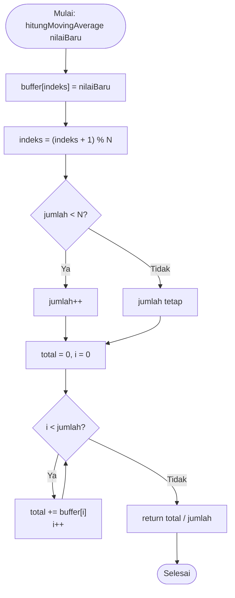

Nama: Gerard Roland Kusuma Sarwoko  
NIM: H1H024047  
Shift Awal: B  
Shift Akhir: C  

---

# Modul 5 - Pengolahan dan Analisis Data IoT (Filtering, Analisis, dan Visualisasi)

## Ringkasan Praktikum
| Percobaan | Lokasi pengolahan | Isi |
|---|---|---|
| 5A | Edge (mikrokontroler) | Moving average 5 sampel, nilai min/max, simpangan baku (tugas tambahan) |
| 5B | Komputer (Python) | Ambil data via MQTT, simpan CSV, statistik, deteksi anomali z-score, grafik; tugas tambahan: moving average sebelum z-score |

## Library / Dependencies
| Library | Fungsi |
|---|---|
| `DHT sensor library` (Adafruit) | Membaca sensor suhu (5A) |
| Python 3 | Bahasa untuk analisis |
| `paho-mqtt` (v2.x) | Subscribe data dari broker MQTT |
| `pandas` | Pengelolaan data tabular dan statistik |
| `matplotlib` | Membuat grafik |

Instalasi: `pip install paho-mqtt pandas matplotlib`

> **Catatan:** pada 5A, `DHTPIN 4` adalah nomor GPIO4. Pada ESP8266 GPIO4 sama dengan pin **D2**, sama seperti pin DHT pada Modul 4, jadi kodenya dapat dipakai langsung tanpa mengubah pin. Sesuaikan `DHTTYPE` (DHT11/DHT22) dengan sensor yang dipakai. Untuk 5B, ESP8266 menjalankan program publish suhu dari Modul 4 (4B) dengan `topicData` yang sama dengan `TOPIC` pada Python.

# Percobaan 5A - Pengolahan Data Sensor di Perangkat (Moving Average dan Statistik)

## Penjelasan Singkat Percobaan
Mikrokontroler membaca suhu tiap 2 detik, memfilternya dengan moving average dari 5 pembacaan terakhir, mencatat suhu minimum dan maksimum, lalu menampilkan data mentah, hasil filter, simpangan baku, min, dan max di Serial Monitor.

## Pertanyaan Praktikum - Percobaan 5A

### 1. Gambarkan diagram alur (flowchart) proses perhitungan moving average pada fungsi `hitungMovingAverage()`!



### 2. Jelaskan fungsi dari operasi `(indeks + 1) % N` pada program tersebut!
Operasi ini membuat buffer bekerja secara melingkar. Nilai baru ditulis ke `buffer[indeks]`, lalu `indeks` maju satu langkah. Karena memakai sisa bagi `N`, saat `indeks` mencapai `N` ia kembali ke 0 (untuk N = 5: 0, 1, 2, 3, 4, 0, 1, ...). Dengan begitu indeks tidak pernah melewati batas array, data paling lama otomatis tertimpa oleh data terbaru, dan buffer selalu berisi N pembacaan terakhir tanpa harus menggeser seluruh isi array.

### 3. Apa dampaknya terhadap data hasil filter apabila nilai N diperbesar menjadi 20 atau diperkecil menjadi 2?
| Nilai N | Kehalusan | Kecepatan respons |
|---|---|---|
| Besar (20) | Sangat halus, derau sesaat teredam | Lambat: perubahan suhu nyata baru tampak penuh setelah ±20 pembacaan (±40 detik pada interval 2 detik); buffer memakai lebih banyak memori |
| Kecil (2) | Kurang halus, hasil nyaris sama dengan data mentah | Cepat mengikuti perubahan, tetapi derau ikut lolos |

Jadi pemilihan N adalah kompromi antara kehalusan data dan kecepatan respons.

### 4. Modifikasi program agar juga menghitung simpangan baku dari data pada buffer!

```cpp
// Modul 5 - Percobaan 5A (Modifikasi)
// Moving Average (N = 5) + Min/Max + Simpangan Baku

#include <DHT.h>

#define DHTPIN 4        // GPIO4 (= D2 pada ESP8266)
#define DHTTYPE DHT22   // sesuaikan dengan sensor (DHT11/DHT22)
DHT dht(DHTPIN, DHTTYPE);

const int N = 5;
float buffer[N];
int indeks = 0;
int jumlah = 0;
float suhuMin = 1000.0;
float suhuMax = -1000.0;

float hitungMovingAverage(float nilaiBaru) {
  buffer[indeks] = nilaiBaru;
  indeks = (indeks + 1) % N;
  if (jumlah < N) jumlah++;
  float total = 0;
  for (int i = 0; i < jumlah; i++) {
    total += buffer[i];
  }
  return total / jumlah;
}

// [BARU] Menghitung simpangan baku (sampel) dari isi buffer
float hitungSimpanganBaku(float rataRata) {
  if (jumlah < 2) return 0.0;                  // [BARU] butuh minimal 2 data
  float jumlahKuadrat = 0;                     // [BARU] penampung total kuadrat selisih
  for (int i = 0; i < jumlah; i++) {           // [BARU] untuk setiap data terisi
    float selisih = buffer[i] - rataRata;      // [BARU] selisih terhadap rata-rata
    jumlahKuadrat += selisih * selisih;        // [BARU] kuadratkan lalu jumlahkan
  }
  return sqrt(jumlahKuadrat / (jumlah - 1));   // [BARU] akar dari (total / (n-1))
}

void setup() {
  Serial.begin(115200);
  dht.begin();
}

void loop() {
  float suhu = dht.readTemperature();
  if (isnan(suhu)) {
    Serial.println("Pembacaan gagal, data diabaikan");
  } else {
    float suhuFilter = hitungMovingAverage(suhu);
    float simpangan = hitungSimpanganBaku(suhuFilter);  // [BARU]
    if (suhu < suhuMin) suhuMin = suhu;
    if (suhu > suhuMax) suhuMax = suhu;

    Serial.print("Mentah: ");
    Serial.print(suhu);
    Serial.print(" | Filter: ");
    Serial.print(suhuFilter);
    Serial.print(" | StdDev: ");               // [BARU]
    Serial.print(simpangan);                   // [BARU]
    Serial.print(" | Min: ");
    Serial.print(suhuMin);
    Serial.print(" | Max: ");
    Serial.println(suhuMax);
  }
  delay(2000);
}
```

**Penjelasan baris kode yang ditambahkan ([BARU]):**

| Baris | Penjelasan |
|---|---|
| `float hitungSimpanganBaku(float rataRata)` | Fungsi baru; menerima rata-rata yang sudah dihitung oleh moving average supaya tidak dihitung dua kali. |
| `if (jumlah < 2) return 0.0;` | Simpangan baku sampel membagi dengan `jumlah - 1`. Dengan satu data, pembaginya nol, jadi hasilnya ditetapkan 0. |
| `float jumlahKuadrat = 0;` | Variabel penampung total kuadrat selisih. |
| `for (int i = 0; i < jumlah; i++)` | Mengulang hanya sebanyak data yang sudah terisi (bukan N penuh), sehingga hasil awal tetap benar. |
| `float selisih = buffer[i] - rataRata;` | Jarak tiap data terhadap rata-rata. |
| `jumlahKuadrat += selisih * selisih;` | Dikuadratkan agar selisih negatif dan positif tidak saling menghapus. |
| `return sqrt(jumlahKuadrat / (jumlah - 1));` | Rumus simpangan baku sampel; hasilnya selaras dengan `std()` pada pandas di 5B. |
| `float simpangan = hitungSimpanganBaku(suhuFilter);` | Memanggil fungsi tiap kali ada pembacaan valid. |
| `Serial.print(" \| StdDev: "); Serial.print(simpangan);` | Menampilkan hasil. Nilai kecil berarti data stabil, nilai besar berarti suhu sedang berfluktuasi. |

**Penjelasan fungsi dan percabangan keseluruhan program:**

| Bagian | Penjelasan |
|---|---|
| `hitungMovingAverage()` | Menyimpan nilai ke buffer melingkar, lalu mengembalikan rata-rata data terisi. |
| `if (jumlah < N) jumlah++` | Selama buffer belum penuh, pembagi rata-rata hanya sebanyak data yang ada. |
| `if (isnan(suhu))` | Membuang pembacaan gagal agar tidak merusak filter. |
| `if (suhu < suhuMin)` / `if (suhu > suhuMax)` | Memperbarui min dan max; nilai awal 1000 dan -1000 dipakai agar pembacaan pertama pasti menggantikannya. |

---

# Percobaan 5B - Akuisisi, Analisis, dan Visualisasi Data

## Penjelasan Singkat Percobaan
Program Python subscribe ke topic data yang di-publish ESP8266, mengumpulkan sejumlah sampel, menyimpannya ke `data_suhu.csv` beserta waktu penerimaan, menghitung statistik (rata-rata, std, min, max), mendeteksi anomali dengan z-score (|z| > 2), dan membuat grafik dengan penanda anomali.

```python
import json
import time
import paho.mqtt.client as mqtt
import pandas as pd
import matplotlib.pyplot as plt

BROKER = "broker.hivemq.com"
PORT = 1883
TOPIC = "unsoed/tk245004/kelompokwewenroland/data"  # sama dengan topicData pada mikrokontroler
JUMLAH_SAMPEL = 30   # jumlah data yang dikumpulkan

data = []

def on_connect(client, userdata, flags, reason_code, properties):
    print("Terhubung ke broker, kode:", reason_code)
    client.subscribe(TOPIC)

def on_message(client, userdata, msg):
    try:
        payload = json.loads(msg.payload.decode())
        suhu = float(payload["suhu"])
    except (ValueError, KeyError):
        print("Data tidak valid, diabaikan")
        return

    data.append({"waktu": time.strftime("%Y-%m-%d %H:%M:%S"), "suhu": suhu})
    print(f"[{len(data)}/{JUMLAH_SAMPEL}] suhu = {suhu}")

    if len(data) >= JUMLAH_SAMPEL:
        client.disconnect()      # berhenti setelah data cukup

# --- Tahap 1: akuisisi data dari MQTT ---
client = mqtt.Client(mqtt.CallbackAPIVersion.VERSION2)
client.on_connect = on_connect
client.on_message = on_message
client.connect(BROKER, PORT)
client.loop_forever()

# --- Tahap 2: simpan ke CSV ---
df = pd.DataFrame(data)
df.to_csv("data_suhu.csv", index=False)
print("Data tersimpan di data_suhu.csv")

# --- Tahap 3: statistik dan deteksi anomali (z-score) ---
rata2 = df["suhu"].mean()
std = df["suhu"].std()

if std == 0:
    df["zscore"] = 0.0           # hindari pembagian dengan nol
else:
    df["zscore"] = (df["suhu"] - rata2) / std
df["anomali"] = df["zscore"].abs() > 2

print(f"Rata-rata : {rata2:.2f}")
print(f"Std deviasi: {std:.2f}")
print(f"Minimum : {df['suhu'].min():.2f}")
print(f"Maksimum : {df['suhu'].max():.2f}")
print(f"Jumlah anomali: {df['anomali'].sum()}")

# --- Tahap 4: visualisasi ---
plt.figure(figsize=(10, 4))
plt.plot(df.index, df["suhu"], marker="o", label="Suhu")
anom = df[df["anomali"]]
plt.scatter(anom.index, anom["suhu"], color="red", s=100, label="Anomali", zorder=3)
plt.axhline(rata2, color="gray", linestyle="--", label="Rata-rata")
plt.xlabel("Urutan data")
plt.ylabel("Suhu (°C)")
plt.title("Data Suhu dan Deteksi Anomali")
plt.legend()
plt.tight_layout()
plt.savefig("grafik_suhu.png")
plt.show()
```

**Penjelasan alur program:**

| Bagian | Penjelasan |
|---|---|
| `on_connect` | Dipanggil saat tersambung ke broker; langsung subscribe ke `TOPIC`. |
| `on_message` | Dipanggil tiap pesan masuk: payload di-decode dan di-parse JSON, nilai `suhu` diambil, lalu dicatat bersama waktu ke list `data`. Setelah `JUMLAH_SAMPEL` terkumpul, `client.disconnect()` mengakhiri `loop_forever()`. |
| `if len(data) >= JUMLAH_SAMPEL` (percabangan) | Penentu kapan akuisisi berhenti. |
| `client.loop_forever()` | Menahan program menunggu pesan sampai `disconnect()`; setelah itu tahap 2-4 berjalan. |
| `pd.DataFrame` + `to_csv` | Mengubah list menjadi tabel dan menyimpannya ke CSV. |
| `if std == 0` (percabangan) | Mencegah pembagian nol jika semua data sama. |
| `df["anomali"] = ... > 2` | Menandai data dengan \|z\| lebih dari 2. |
| `plt.*` | Menggambar garis data, titik merah anomali, dan garis rata-rata, lalu menyimpannya ke `grafik_suhu.png`. |

## Pertanyaan Praktikum - Percobaan 5B

### 1. Jelaskan fungsi dari blok try-except pada fungsi `on_message()` dan apa yang terjadi apabila blok tersebut dihilangkan!
Blok `try-except` menjaga program dari pesan yang rusak. Di dalam `try`, payload di-parse dengan `json.loads()` dan nilai `suhu` dikonversi ke float. Jika payload bukan JSON valid atau bukan angka, muncul `ValueError`; jika key `suhu` tidak ada, muncul `KeyError`. Kedua error ditangkap oleh `except`: program mencetak "Data tidak valid, diabaikan" lalu `return`, sehingga data cacat tidak masuk ke list `data`. Jika blok ini dihapus, error menjadi exception tak tertangani di dalam callback. Program bisa berhenti mendadak, akuisisi terputus, dan data yang sudah terkumpul tidak sempat disimpan ke CSV maupun dianalisis.

### 2. Jelaskan arti nilai z-score dan mengapa batas |z| > 2 digunakan sebagai penentu anomali!
Z-score = (x − rata-rata) / simpangan baku; nilainya menyatakan berapa simpangan baku sebuah data berjarak dari rata-rata. z = 0 tepat di rata-rata, z = +2 berarti dua simpangan baku di atasnya, z = −2 dua simpangan baku di bawahnya. Pada data yang mendekati distribusi normal, sekitar 95% data jatuh dalam ±2 simpangan baku, sehingga data di luar rentang itu tergolong langka (±5%) dan layak dicurigai sebagai anomali. Batas 2 adalah titik awal yang praktis: lebih longgar dari 1,5 (yang menandai terlalu banyak data) dan lebih sensitif daripada 3. Nilainya dapat diubah sesuai kebutuhan.

### 3. Apa kelemahan metode z-score apabila data memiliki tren naik atau turun yang tajam?
Z-score memakai satu rata-rata dan satu simpangan baku untuk seluruh data, sehingga mengasumsikan data bergerak di sekitar satu nilai tengah. Pada data bertren tajam, nilai di awal dan akhir tren jauh dari rata-rata keseluruhan sehingga mudah dilabeli anomali padahal itu perubahan wajar (false positive), sementara simpangan baku yang membesar akibat tren dapat menyembunyikan lonjakan nyata (false negative). Kelemahan lain: rata-rata dan simpangan baku sendiri terpengaruh anomali, dan metode ini mengasumsikan distribusi mendekati normal. Solusinya antara lain z-score pada jendela bergerak atau menghilangkan tren lebih dulu.

### 4. Modifikasi program agar menggunakan moving average (jendela 5 data) pada data hasil CSV sebelum dihitung z-score-nya, lalu bandingkan jumlah anomali!

Skrip ini dijalankan setelah `data_suhu.csv` terbentuk dari program akuisisi di atas.

```python
# Modul 5 - Percobaan 5B (Modifikasi)
# Moving average (jendela 5) pada data CSV sebelum z-score,
# lalu membandingkan jumlah anomali
import pandas as pd
import matplotlib.pyplot as plt

JENDELA = 5   # [BARU] ukuran jendela moving average
BATAS_Z = 2   # [BARU] batas |z| untuk anomali

df = pd.read_csv("data_suhu.csv")  # [BARU] baca data hasil akuisisi dari CSV

def hitung_zscore(seri):           # [BARU] fungsi z-score agar dipakai dua kali
    rata2 = seri.mean()
    std = seri.std()
    if std == 0:                   # hindari pembagian dengan nol
        return pd.Series(0.0, index=seri.index)
    return (seri - rata2) / std

# --- Metode A: z-score pada data mentah ---
df["z_mentah"] = hitung_zscore(df["suhu"])             # [BARU]
df["anomali_mentah"] = df["z_mentah"].abs() > BATAS_Z  # [BARU]

# --- Metode B: moving average dulu, baru z-score ---
df["suhu_ma"] = df["suhu"].rolling(window=JENDELA, min_periods=1).mean()  # [BARU]
df["z_ma"] = hitung_zscore(df["suhu_ma"])              # [BARU]
df["anomali_ma"] = df["z_ma"].abs() > BATAS_Z          # [BARU]

# --- Perbandingan ---
print(f"Jumlah data : {len(df)}")                                    # [BARU]
print(f"Anomali data mentah : {df['anomali_mentah'].sum()}")         # [BARU]
print(f"Anomali setelah MA ({JENDELA}) : {df['anomali_ma'].sum()}")  # [BARU]
print(f"Std data mentah : {df['suhu'].std():.4f}")                   # [BARU]
print(f"Std data setelah MA : {df['suhu_ma'].std():.4f}")            # [BARU]

df.to_csv("data_suhu_ma.csv", index=False)     # [BARU]
print("Hasil tersimpan di data_suhu_ma.csv")   # [BARU]

# --- Visualisasi perbandingan ---
fig, ax = plt.subplots(2, 1, figsize=(10, 7), sharex=True)  # [BARU] dua grafik atas-bawah

ax[0].plot(df.index, df["suhu"], marker="o", label="Suhu mentah")
a1 = df[df["anomali_mentah"]]
ax[0].scatter(a1.index, a1["suhu"], color="red", s=100, label="Anomali", zorder=3)
ax[0].axhline(df["suhu"].mean(), color="gray", linestyle="--", label="Rata-rata")
ax[0].set_title("Z-score pada data mentah")
ax[0].set_ylabel("Suhu (°C)")
ax[0].legend()

ax[1].plot(df.index, df["suhu_ma"], marker="o", color="green", label=f"Suhu MA ({JENDELA})")
a2 = df[df["anomali_ma"]]
ax[1].scatter(a2.index, a2["suhu_ma"], color="red", s=100, label="Anomali", zorder=3)
ax[1].axhline(df["suhu_ma"].mean(), color="gray", linestyle="--", label="Rata-rata")
ax[1].set_title(f"Z-score setelah moving average (jendela {JENDELA})")
ax[1].set_xlabel("Urutan data")
ax[1].set_ylabel("Suhu (°C)")
ax[1].legend()

plt.tight_layout()
plt.savefig("grafik_perbandingan.png")  # [BARU]
plt.show()
```

**Penjelasan baris kode yang ditambahkan ([BARU]):**

| Baris | Penjelasan |
|---|---|
| `JENDELA = 5`, `BATAS_Z = 2` | Konstanta agar ukuran jendela dan ambang anomali mudah diubah di satu tempat. |
| `pd.read_csv("data_suhu.csv")` | Memuat data dari file CSV, sesuai soal yang meminta pengolahan pada data hasil CSV. |
| `def hitung_zscore(seri)` | Fungsi umum yang menghitung z-score untuk satu kolom, sehingga rumus yang sama dipakai pada data mentah dan data terfilter. Bila std = 0, semua z diisi 0. |
| `df["anomali_mentah"]` | Penanda anomali dari data asli sebagai pembanding. |
| `rolling(window=JENDELA, min_periods=1).mean()` | Rata-rata bergerak 5 data terakhir. `min_periods=1` membuat 4 data pertama tetap dihitung dari data yang ada, bukan NaN. |
| `df["z_ma"]`, `df["anomali_ma"]` | Z-score dan penanda anomali untuk data yang sudah dihaluskan. |
| `print(... .sum())` | `.sum()` pada kolom boolean menghitung jumlah `True`, yaitu jumlah anomali; dicetak untuk kedua metode agar dibandingkan. |
| `print(... std ...)` | Menampilkan simpangan baku sebelum dan sesudah filter; menunjukkan efek penghalusan. |
| `df.to_csv("data_suhu_ma.csv")` | Menyimpan hasil lengkap (z-score, anomali) untuk dokumentasi. |
| `plt.subplots(2, 1, ..., sharex=True)` | Dua grafik bertumpuk dengan sumbu x yang sama, memudahkan perbandingan visual. |
| `plt.savefig("grafik_perbandingan.png")` | Menyimpan grafik perbandingan. |

**Hasil perbandingan** (isi dari output programmu):

| Metode | Jumlah anomali |
|---|---|
| Data mentah | (isi) |
| Setelah moving average (jendela 5) | (isi) |

Pada umumnya jumlah anomali setelah moving average lebih sedikit atau sama, karena lonjakan sesaat diredam oleh rata-rata jendela; yang tersisa hanya perubahan yang bertahan beberapa sampel.

---

## Pertanyaan Analisis

### 1. Uraikan hasil tugas pada praktikum yang telah dilakukan pada setiap percobaan!
**Percobaan 5A:** Serial Monitor menampilkan data mentah, hasil moving average, simpangan baku, min, dan max tiap 2 detik. Saat sensor diberi gangguan, data mentah berubah cepat sedangkan hasil filter bergerak lebih landai dan tertinggal, dan simpangan baku ikut membesar selama gangguan.

**Percobaan 5B:** Program Python menerima data suhu dari broker MQTT, menyimpannya ke `data_suhu.csv` dengan stempel waktu, menampilkan statistik dan jumlah anomali, serta menghasilkan `grafik_suhu.png`. Pada tugas tambahan, moving average 5 data diterapkan sebelum z-score dan jumlah anomali dibandingkan: (isi hasilmu).

### 2. Bandingkan pengolahan data di sisi perangkat (5A) dengan di sisi komputer (5B) dari segi kecepatan, kompleksitas analisis, dan kebutuhan sumber daya!
| Aspek | Perangkat / edge (5A) | Komputer / Python (5B) |
|---|---|---|
| Kecepatan | Hasil langsung tersedia tiap pembacaan, tanpa menunggu jaringan | Ada tunda karena data dikirim lewat jaringan dan baru dianalisis setelah sampel cukup |
| Kompleksitas analisis | Sederhana (moving average, min/max, std) karena CPU dan RAM terbatas | Dapat kompleks: statistik, z-score, visualisasi, bahkan machine learning |
| Sumber daya | Hemat perangkat keras, tetapi membebani mikrokontroler yang kecil | Butuh komputer dan library, namun memori dan penyimpanan melimpah untuk data historis |
| Volume data kirim | Bisa dikurangi karena data diringkas dulu | Menerima seluruh data mentah |

Keduanya saling melengkapi: pengolahan ringan di edge untuk respons cepat, analisis berat di komputer atau cloud.

### 3. Bagaimana pengaruh pemilihan ukuran jendela moving average terhadap kualitas data dan kecepatan respons sistem kendali apabila data tersebut digunakan untuk mengendalikan aktuator?
Jendela besar membuat data halus sehingga aktuator tidak mudah hidup-mati karena derau sesaat, tetapi hasil filter tertinggal dari kondisi sebenarnya sehingga aktuator telat bereaksi saat suhu benar-benar naik. Jendela kecil membuat respons cepat, namun data lebih berderau dan aktuator rentan terpicu palsu. Ukuran jendela perlu disesuaikan dengan proses yang dikendalikan: proses lambat seperti suhu ruangan cocok dengan jendela lebih besar, sedangkan proses yang menuntut respons cepat memakai jendela lebih kecil.

### 4. Bagaimana hasil analisis dan deteksi anomali dapat dimanfaatkan untuk meningkatkan keandalan sistem IoT, misalnya pada smart farming atau smart home?
Deteksi anomali menyaring data janggal sebelum dipakai mengambil keputusan. Pada smart farming, lonjakan atau penurunan mendadak pada kelembaban tanah dapat ditandai anomali sehingga pompa tidak menyala hanya karena sensor error, dan anomali berulang dapat memicu notifikasi agar sensor diperiksa. Pada smart home, kenaikan suhu yang tidak wajar dapat dikenali sebagai tanda awal masalah (misalnya AC rusak atau risiko kebakaran) dan memicu alarm lebih dini. Data yang sudah difilter membuat kendali aktuator lebih stabil dengan alarm palsu lebih sedikit, dan data historis di CSV dapat dipakai untuk merawat sensor secara prediktif.
